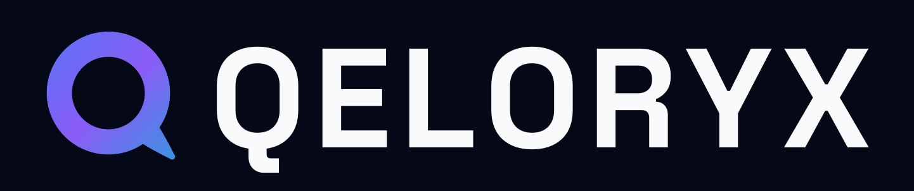

<p align="center">
  
</p>

# Qeloryx

**Hear Beyond. Build Beyond.**

Qeloryx is an iOS music-player project built around an offline-first library, playback, discovery, and a focused Midnight Aurora interface. The repository contains the app, reusable Swift packages, engineering documentation, and GitHub Actions workflows.

> **Status:** Early development (`0.0.1-dev`). Expect incomplete features and breaking changes. This is not an App Store release. The first development release will be published as a GitHub prerelease when its tagged build passes CI.

## Project at a glance

- **Platform:** iOS 17+
- **Language/tooling:** Swift 5.9+, Swift Package Manager, XcodeGen, Xcode
- **App:** SwiftUI interface with AVFoundation-backed platform integration
- **Packages:** `QeloryxCore`, `QeloryxDesignSystem`, and `QeloryxPlatform`
- **Dependencies:** No external Swift package dependencies currently declared
- **Roadmap:** `Docs/FEATURE_MATRIX.md` tracks every planned player capability and its sprint
- **Attribution:** `THIRD-PARTY-NOTICES.md` records third-party reuse policy and components

## Features in development

The codebase includes playback and queue components (with gapless/crossfade planning and ReplayGain normalization), library and metadata handling (with smart playlists and M3U playlist import/export), indexed search, lyrics models, download workflows, Taste DNA/recommendation components, a design system, and iOS platform adapters. Some screens and data paths are prototypes or use sample data; feature presence in source does not imply production readiness or a completed end-to-end user experience. Feature ideas are benchmarked against top open-source music players — see [Docs/SHM/SHM-009](Docs/SHM/SHM-009-oss-feature-benchmark.md) and [Docs/SHM/SHM-010](Docs/SHM/SHM-010-oss-master-list.md).

## Branding

The app icon, the aurora **Q** mark, and the wordmark lockups are all generated
from the same source of truth as the interface: the Midnight Aurora tokens in
`Qeloryx/DesignSystem/Colors/AstryxColors.swift`.

| Asset | Path |
|---|---|
| App icon (all iOS sizes, 1024 marketing) | `Qeloryx/Resources/Assets.xcassets/AppIcon.appiconset` |
| In-app mark | `Qeloryx/Resources/Assets.xcassets/BrandLogo.imageset` |
| Accent colour (`#3B82F6`) | `Qeloryx/Resources/Assets.xcassets/AccentColor.colorset` |
| Lockups and brand sheet | `Docs/Branding/` |
| Logo typeface (Space Grotesk, OFL-1.1) | `Qeloryx/Resources/Fonts/` |

Regenerate everything after any palette change:

```sh
python3 -m pip install Pillow
python3 Tools/branding/build_brand_assets.py
```

The generator draws at 4x and downsamples, so the mark is identical at 20 px and
at 1024 px. Do not hand-edit the PNGs — they are build output, and the next
regeneration will overwrite them. Usage rules and the palette are documented in
[`Docs/BRANDING.md`](Docs/BRANDING.md).

## Requirements

- macOS with Xcode installed (the project configuration currently targets Xcode 15.4 / Swift 5.9)
- XcodeGen (`brew install xcodegen`) to generate the native project
- SwiftLint (`brew install swiftlint`) for local linting

## Build and test

```sh
# Portable package build and tests
swift build
swift test

# Generate the iOS project and build for an available simulator SDK
xcodegen generate
xcodebuild -project Qeloryx.xcodeproj \
  -scheme Qeloryx \
  -destination 'generic/platform=iOS Simulator' \
  CODE_SIGNING_ALLOWED=NO build

# Lint
swiftlint lint --strict
```

For local setup helpers, see [`.github/scripts/bootstrap.sh`](.github/scripts/bootstrap.sh), [`.github/scripts/lint.sh`](.github/scripts/lint.sh), and [`.github/scripts/generate-docs.sh`](.github/scripts/generate-docs.sh). Generated Xcode projects, build output, and signing assets should not be committed.

## Repository layout

The app follows a layered architecture — composition → views → view models → services → models — with platform adapters isolating Apple frameworks:

```text
Qeloryx/             All app sources (single app module under XcodeGen)
├── App/             Composition root, lifecycle (AppRouter, AppLifecycle, AppDependencies.live())
├── Models/          Domain value types (Music, Library, Playback, Downloads, Providers, Lyrics, Recommendations)
├── Views/           SwiftUI screens (Main, Home, Discover, Library, Search, Player, Queue, Lyrics,
│                    Downloads, AudioLab, Statistics, Social, Settings) + Components/
├── ViewModels/      One ObservableObject per screen
├── Services/        Portable domain services (Player, DSP, Library, Downloads, Search, Metadata,
│                    Recommendations, Lyrics, Providers, Persistence, Security, Networking, …)
├── Platform/        Apple framework adapters (Audio, Background, MediaControls, FileSystem,
│                    Notifications, AppleServices, CarPlay, Widgets)
├── DesignSystem/    Midnight Aurora tokens and components (Theme, Colors, Typography, Spacing,
│                    Materials, Components, Motion)
├── Utilities/       Extensions, Diagnostics, Logging, Helpers (event bus, protocols)
└── Resources/       Assets.xcassets, Fonts, Localizable.xcstrings
QeloryxTests/        Unit tests, categorized (Unit, Integration, Service, ProviderContract,
                     AudioEngine, Persistence, Performance)
QeloryxUITests/      UI tests (Navigation, Playback, Library, Download)
Configuration/       Shared/Debug/Release .xcconfig build configuration
Docs/                Architecture decisions, build and release guidance
.github/scripts/     Local developer and release utilities
.github/workflows/   CI, build, performance checks, and release automation
```

See [`Docs/ARCHITECTURE.md`](Docs/ARCHITECTURE.md) for the full design and the old→new mapping.

## CI and releases

Pull requests and branch pushes are checked by GitHub Actions. The checks cover Swift package build/tests, lint, generated iOS project build, and documentation/repository sanity. A failed required check is a signal to fix the underlying issue; workflows must not silently turn build or test failures into success.

Development releases use annotated semantic-version tags, for example `v0.0.1-dev.1`. Pushing a tag triggers validation and creates a GitHub **prerelease** with the build artifacts and generated release notes. Two assets are attached: `Qeloryx.ipa`, an **unsigned arm64 device build** that can be sideloaded with AltStore, SideStore, Esign, Feather, or TrollStore after local signing; and `Qeloryx-simulator.zip`, an **unsigned simulator build** for evaluation. Neither is an App Store-signed distribution; signed TestFlight/App Store delivery requires Apple Developer credentials managed outside source control. See [`Docs/RELEASE_FLOW.md`](Docs/RELEASE_FLOW.md) and [`CHANGELOG.md`](CHANGELOG.md).

To start a development release, first ensure the desired commit is on the intended release branch and CI is green, then create and push a unique tag:

```sh
git tag -a v0.0.1-dev.1 -m "Qeloryx 0.0.1 development 1"
git push origin v0.0.1-dev.1
```

Do not reuse or force-update published tags. For TestFlight/App Store distribution, configure Apple signing credentials and a separate protected distribution workflow; none are stored in this repository.

## Engineering documentation

- [Build readiness](Docs/BUILD_READINESS.md)
- [Release flow](Docs/RELEASE_FLOW.md)
- [Architecture Decision Records](Docs/ADR/)
- [Engineering plans](Docs/EPL/)
- [Implementation logs](Docs/IL/)
- [Research notes](Docs/SHM/)

## Contributing

Use focused branches and pull requests, describe user-visible changes, and add or update tests and documentation where appropriate. Keep secrets, signing material, user audio, and generated build products out of Git. See [CHANGELOG.md](CHANGELOG.md) for recorded project changes.

## License

Proprietary — all rights reserved. See [LICENSE](LICENSE) and [THIRD-PARTY-NOTICES.md](THIRD-PARTY-NOTICES.md).
